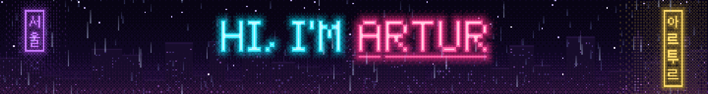

<div align="center">
  
</div>

<div align="center">

[](https://git.io/typing-svg)



<sub>🌃 *"The sky above the port was the color of television, tuned to a dead channel."* · William Gibson, Neuromancer</sub>

<br/>

[](https://www.linkedin.com/in/artur-zavistovskyi-8a186a30b/)
[](https://github.com/artyz1200-hub)


</div>

---

## ⚡ About Me · <sub>소개</sub>

I'm an **M.Sc. student in Social and Economic Data Science** at the University of Konstanz (expected 08/2027) with a technical focus on **Large Language Models** and how to put them to real use.

Alongside my studies, I work as a **Working Student in AI Assistant Systems at Marsh**, where I help with internal AI initiatives and AI-powered assistants for clients, and structure large volumes of data for those assistants to work on.

My project work covers **multi-agent systems, RAG workflows, prompt engineering and evaluating model outputs**, and I also do computer vision: object detection for autonomous race cars with the **Bodensee Racing Team**, depth estimation, and satellite damage mapping.

```yaml
artur:
  focus:      [LLMs, Multi-Agent Systems, RAG, Prompt Engineering, LLM Evaluation]
  also:       [Computer Vision, NLP, Deep Learning, Data Analysis]
  now:        Working Student — AI Assistant Systems @ Marsh
  studying:   M.Sc. Social & Economic Data Science @ University of Konstanz
  languages:  { German: C1, English: C1, Ukrainian: native, Russian: native }
```

---

## 🧰 Tech Stack · <sub>기술</sub>

<div align="center">

**Languages**


**AI & GenAI**


**ML, Deep Learning & Computer Vision**


**Apps, Cloud & Tooling**


</div>

---

## 🛰️ Featured Projects · <sub>프로젝트</sub>

| Project | What it does | Stack |
|:--|:--|:--|
| 🤖 **[Multi-Agent Heatwave Simulation](https://github.com/BhuvaneshWadhwani/heatwave-water-scarcity-simulation)** | LLM agents with different roles interact and make decisions in a heatwave and water-scarcity scenario; prompts iterated and evaluated across many runs. Team project. | `LLM agents` `Prompting` `Python` |
| 🔎 **[How-To Multimodal RAG](https://github.com/artyz1200-hub/how-to-multimodal-rag)** | End-to-end assistant: retrieves WikiHow articles, generates grounded step-by-step answers with a local LLM, illustrates each step with a HowTo100M clip, summarises history when the context fills up. | `RAG` `FAISS` `Transformers` `Gradio` |
| 🧬 **[Masked Fine-Tuning with Qwen](https://github.com/artyz1200-hub/masked-finetuning-qwen)** | Patent classification pipeline with Qwen 3, PEFT (LoRA) and a completion-only loss. | `LLM fine-tuning` `PEFT` `LoRA` |
| 🛰️ **[Satellite Disaster Damage Mapping](https://github.com/artyz1200-hub/satellite-disaster-damage-mapping)** | Damage assessment from pre/post-event satellite imagery using Siamese CNNs and transfer learning, evaluated on xBD. | `PyTorch` `Siamese CNN` `CV` |
| 🌊 **[Depth Estimation & Anomaly Detection](https://github.com/artyz1200-hub/depth-estimation-anomaly-detection)** | Monocular depth estimation and unsupervised anomaly detection with Depth-Anything-V2 and DINOv2. | `Vision foundation models` |
| 🏎️ **Bodensee Racing Team** · HTWG Konstanz | Object detection with YOLO and Vision Transformers for an autonomous Formula Student car, integrated into the vehicle software. | `YOLO` `ViT` `PyTorch` |
| 🚦 **[Edinburgh Traffic Accidents](https://github.com/artyz1200-hub/Traffic-accidents-investigation)** | End-to-end exploratory analysis of road accidents with R, Quarto and interactive Leaflet maps. | `R` `Quarto` `Leaflet` |
| 📚 **[Vocabulary Learner](https://github.com/artyz1200-hub/Vocabulary_learner)** | Extracts useful vocabulary from English texts, filters it by CEFR level, fetches definitions and builds Anki flashcards. | `Python` `NLP` |

---

## 💼 Experience · <sub>경력</sub>

- 🏢 **Working Student, AI Assistant Systems** · Marsh, Stuttgart · *09/2026 – present*
  Internal AI initiatives and AI-powered client assistants; structuring large volumes of data as their knowledge base.
- 🏎️ **Computer Vision, Autonomous Systems Team** · Bodensee Racing Team, HTWG Konstanz · *04/2026 – 09/2026*
- 🌍 **Student Assistant, Event Management & Communication** · International Office, University of Konstanz · *09/2024 – 08/2026*
- 📊 **Junior Client Relations & Data Associate** · 1+1 Media Group, Kyiv · *07/2023 – 01/2024*
  Audience and campaign analysis in Excel and Power BI, turned into reports for sales and marketing.

---

## 🏅 Certifications · <sub>자격증</sub>

<div align="center">

| | Certification | Issuer | Issued |
|:-:|:--|:--|:-:|
|  | **AI Fluency: Framework & Foundations** | Anthropic · Claude Academy | Sep 2026 |
|  | **Neo4j & Generative AI** | Neo4j | Sep 2026 |
|  | **Python** | freeCodeCamp | Sep 2026 |
|  | **AI Fundamentals** | DataCamp | Sep 2026 |
|  | **EU AI Act Literacy** | DataCamp | Sep 2026 |
|  | **Data Governance Fundamentals** | DataCamp | Sep 2026 |
|  | **Machine Learning Using Python** | Simplilearn | Jun 2026 |
|  | **R Programming** | DataCamp | Sep 2025 |
|  | **Tidyverse** | DataCamp | Sep 2025 |
|  | **IELTS Academic (C1)** | British Council | Apr 2025 |

<sub>All credentials are listed on <a href="https://www.linkedin.com/in/artur-zavistovskyi-8a186a30b/details/certifications/">LinkedIn</a>.</sub>

</div>

---

## 🌐 Languages · <sub>언어</sub>

<div align="center">


</div>

---

## 🌆 Contribution City · <sub>커밋 시티</sub>

<div align="center">
  
  <sub>Every window is a day. The more I commit, the brighter it glows. Rebuilt twice a day by a GitHub Action.</sub>
</div>
